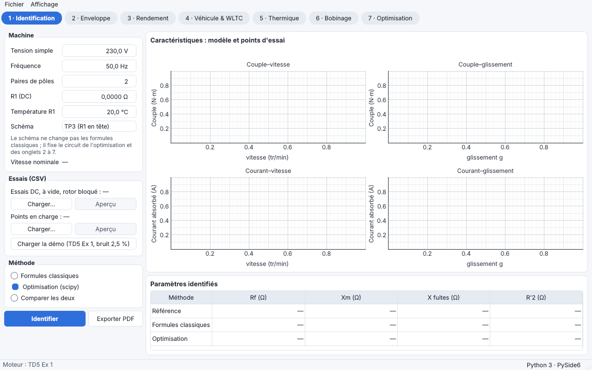
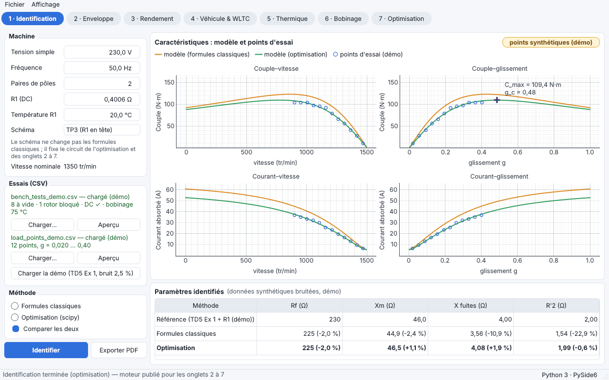
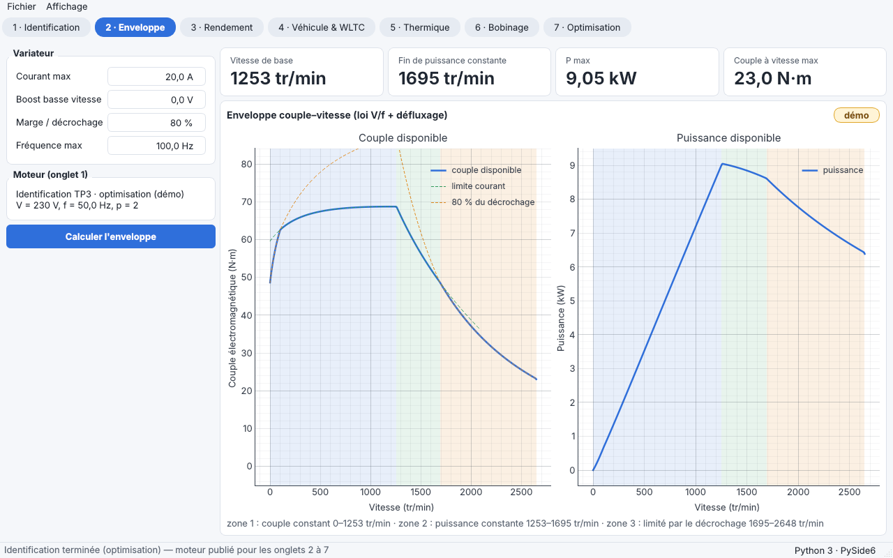
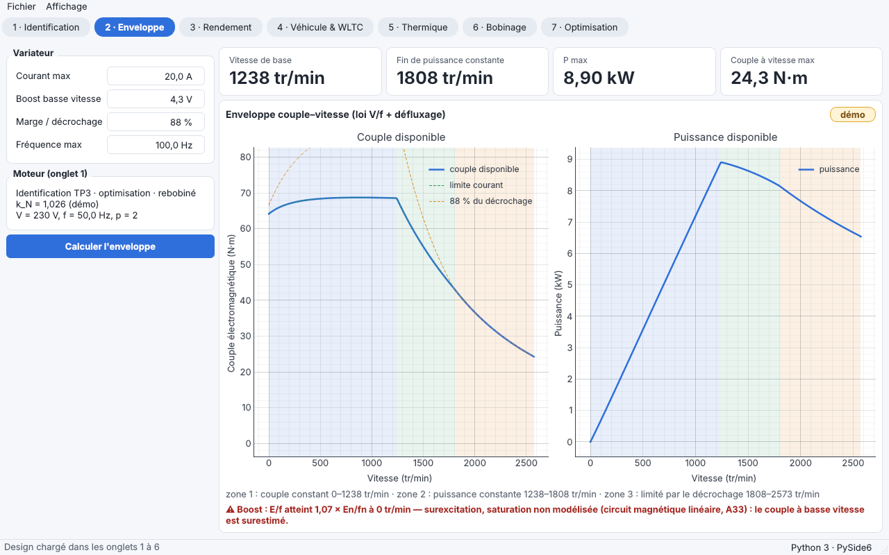
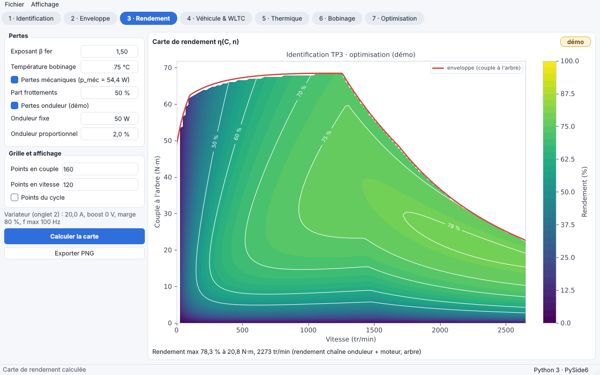
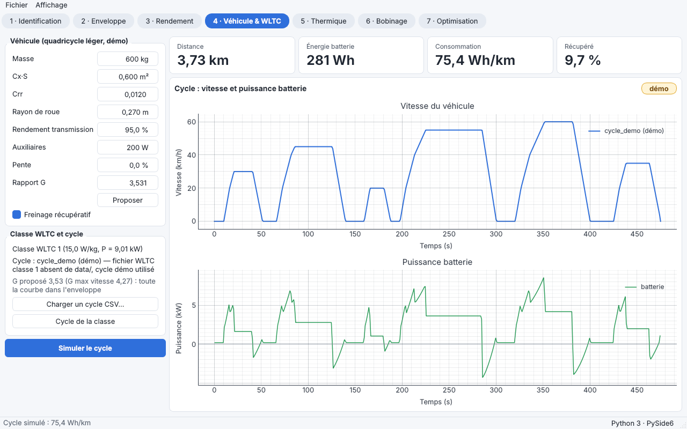
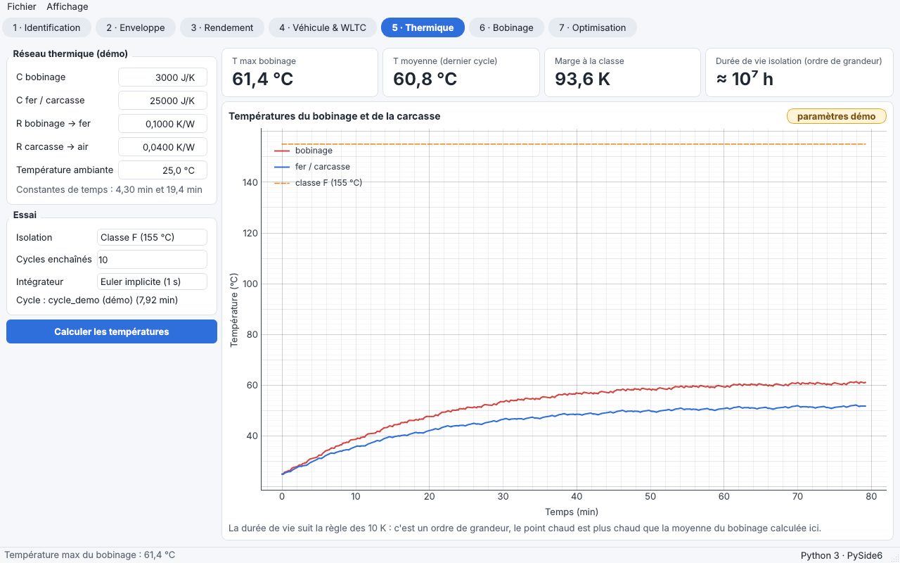
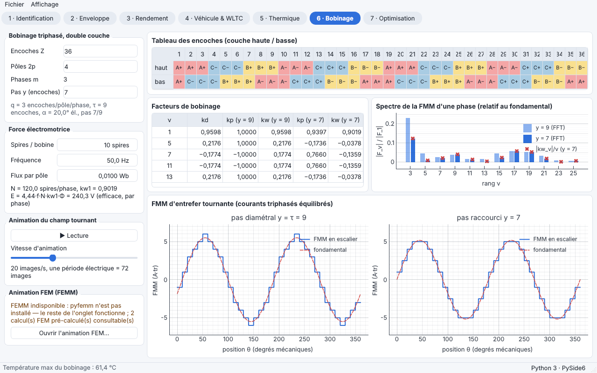
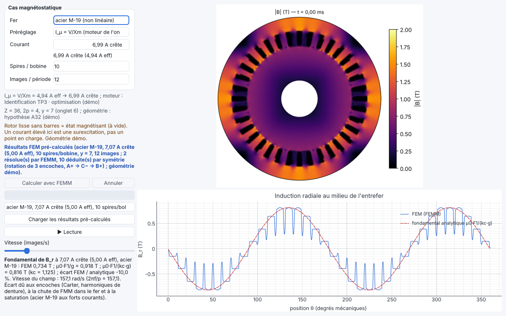
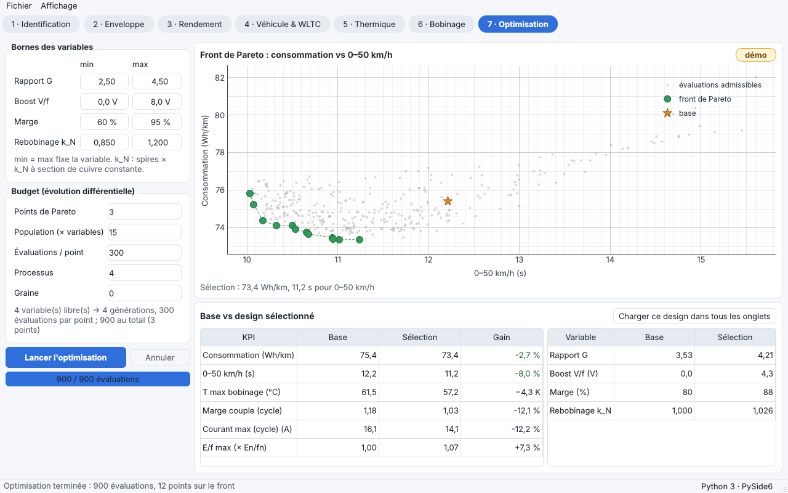

# EV-Traction Lab — Guide d'utilisation

Mini-projet ME3 — ENP Alger, Machines électriques.

Ce guide présente l'application onglet par onglet. Les captures d'écran
(1280 × 800, `docs/images/`) suivent le parcours de démonstration : fichiers démo,
« Comparer les deux », réglages par défaut.
Les nombres affichés utilisent la virgule décimale ; toutes les valeurs « démo »
sont signalées par une pastille ou la mention « (démo) ».

---

## 0. Démarrage

*Fenêtre au démarrage : moteur TD5 Ex 1, aucun essai chargé.*

- **Version Windows** : ouvrir le dossier `EVLab` et lancer `EVLab.exe`. Aucune
  installation de Python n'est nécessaire. Le dossier `EVLab\data` contient les
  fichiers démo ; y déposer les fichiers WLTC officiels (`wltc_class1.csv`,
  `wltc_class3.csv`) quand ils sont disponibles.
- **Depuis les sources** : `python -m evlab`.
- **Auto-test** (sans interaction) : `EVLab.exe --smoke dossier` écrit
  `dossier\smoke.log` (8 à 9 vérifications « ok »).

**Principe : un moteur, une chaîne.** Le moteur identifié dans l'onglet 1 (par
défaut TD5 Ex 1) est celui de tous les autres onglets. La barre d'état indique
toujours le moteur utilisé (« Moteur : … (démo) ») et l'environnement
(« Python 3 · PySide6 »). Les calculs longs tournent en arrière-plan : une barre
de progression s'affiche, l'interface reste utilisable.

**Menu Fichier** : *Exporter PDF…* (rapport A4 de 2 à 3 pages, sections 1 à 6,
encadré des hypothèses, pied de page listant les valeurs démo) et *Exporter
Excel…* (une feuille par module, tableaux bruts en unités SI). Les résultats non
encore calculés sont calculés pour l'export ; l'optimisation est notée « non
calculée » tant qu'elle n'a pas été lancée.

**Menu Affichage** : *Thème clair* (par défaut) ou *Thème sombre* ; le choix est
appliqué tout de suite et retenu au prochain démarrage. Les pastilles ambre
signalent les valeurs démo (le survol liste lesquelles), les pastilles rouges
une alerte (« R1 ≈ 0 … »). Le rapport PDF est toujours en thème clair.

---

## 1. Identification

*Après « Charger la démo » et « Comparer les deux ».*

**But** : obtenir le schéma équivalent en Γ (Rf, Xm, X, R'2, R1, p_méc) à partir
des essais TP3 / TD5.

**Entrées**
- *Machine* : tension simple, fréquence, paires de pôles, R1 (DC) et sa
  température, schéma (« TP3 (R1 en tête) » ou « Bornes »). La vitesse nominale
  est lue dans le fichier (plaque signalétique), elle n'est pas saisie.
- *Essais (CSV)* : fichier d'essais (DC, à vide, rotor bloqué) et fichier de
  points en charge, chacun avec *Charger…* et *Aperçu*. Le bouton
  *Charger la démo (TD5 Ex 1, bruit 2,5 %)* charge les deux fichiers démo.
- *Méthode* : Formules classiques, Optimisation (scipy), Comparer les deux.

**Action** : *Identifier*. Le moteur obtenu est publié pour les onglets 2 à 7
(le résultat de l'optimisation s'il existe, sinon celui des formules classiques).

**Sorties** : quatre courbes, couple–vitesse | couple–glissement en haut et
courant–vitesse | courant–glissement en bas (modèle et points d'essai sur les quatre,
C_max et g_c sur couple–glissement, légende commune en tête), tableau Référence / Formules classiques / Optimisation avec l'écart en %
(l'infobulle donne l'intervalle de confiance à 95 % de l'optimisation).

**À vérifier** : les formules classiques sous-estiment R'2 (rotor bloqué : la
branche magnétisante est négligée, hypothèse A9) ; l'optimisation retrouve la
référence à quelques % près. Un avertissement « paramètres mal séparés » apparaît
si deux paramètres sont trop corrélés (|ρ| > 0,95).

---

## 2. Enveloppe

*Enveloppe du moteur identifié, trois zones.*

*Après « Charger ce design dans tous les onglets » (onglet 7) : boost 4,3 V, avertissement de flux d'entrefer E/f = 1,07 × En/fn (circuit magnétique linéaire, A33).*

**But** : enveloppe couple–vitesse du moteur sous loi V/f puis défluxage.

**Entrées** (*Variateur*, valeurs démo, A16) : courant max, boost basse vitesse,
marge par rapport au décrochage, fréquence max. Le cadre *Moteur (onglet 1)*
rappelle le moteur utilisé.

**Action** : recalcul automatique à chaque changement (ou *Calculer l'enveloppe*).

**Sorties** : quatre tuiles (vitesse de base, fin de puissance constante, P max,
couple à vitesse max) ; courbes couple et puissance avec les trois zones
(couple constant, puissance constante, limitée par le décrochage).

**À vérifier** : la vitesse de base est voisine de la vitesse nominale ; au-delà,
la puissance reste à peu près constante puis décroît quand le décrochage limite.

---

## 3. Rendement

*Carte de rendement avec les points du cycle.*

**But** : carte de rendement η(C, n) à partir des pertes du circuit.

**Entrées** (*Pertes*) : pertes mécaniques de l'essai à vide (case à cocher),
pertes onduleur (démo, fixe + proportionnelle), exposant β du fer (Steinmetz,
A19), température du bobinage (correction de R1), part des frottements (A20).
*Grille et affichage* : nombre de points en couple et en vitesse, affichage des
points du cycle.

**Action** : *Calculer la carte* ; *Exporter PNG*.

**Sorties** : courbes de niveau du rendement (en %), enveloppe en couple à
l'arbre, point de meilleur rendement, points du cycle de l'onglet 4.

**À vérifier** : à 50 Hz la carte redonne exactement le rendement du circuit ; le
rendement chute à faible couple (pertes fer et onduleur fixes).

---

## 4. Véhicule & WLTC

*Cycle démo simulé, classe WLTC 1.*

**But** : véhicule dimensionné pour ce moteur, consommation sur cycle.

**Entrées** (*Véhicule (quadricycle léger, démo)*, A22) : masse, Cx·S, Crr, rayon
de roue, rendement de transmission, auxiliaires, pente, rapport G (*Proposer*
calcule le rapport qui garde tout le cycle dans l'enveloppe) ; *Freinage
récupératif*. *Classe WLTC et cycle* : classe déduite du rapport puissance/masse
(≤ 22 W/kg → classe 1, ≤ 34 W/kg → 2, au-delà → 3), *Cycle de la classe* ou
*Charger un cycle CSV…*.

**Action** : *Simuler le cycle*.

**Sorties** : tuiles distance, énergie batterie, consommation (Wh/km), énergie
récupérée (%) ; courbes vitesse et puissance batterie ; avertissement rouge si
un point du cycle sort de l'enveloppe.

**À vérifier** : sans les fichiers WLTC officiels, l'onglet utilise le cycle
urbain synthétique `cycle_demo.csv` et l'indique (démo, A25).

---

## 5. Thermique

*Dix cycles enchaînés, classe F.*

**But** : échauffement du bobinage sur cycles enchaînés et durée de vie de
l'isolation.

**Entrées** (*Réseau thermique (démo)*, A26) : capacité du bobinage, capacité
fer/carcasse, résistances bobinage → fer et carcasse → air, température
ambiante (les deux constantes de temps sont affichées). *Essai* : classe
d'isolation, nombre de cycles enchaînés, intégrateur (Euler implicite ou RK45).

**Action** : *Calculer les températures*.

**Sorties** : T(t) du bobinage et de la carcasse avec la limite de classe ;
tuiles T max bobinage, T moyenne (dernier cycle), marge à la classe, durée de vie
de l'isolation (ordre de grandeur, règle des 10 K, A28).

**À vérifier** : les pertes cuivre sont recalculées avec R1(T) ; la durée de vie
n'est qu'un ordre de grandeur loin de la température de classe.

---

## 6. Bobinage

*36 encoches, 4 pôles, pas y = 7 ; en dessous, la fenêtre « Animation FEM » (résultats pré-calculés, acier M-19, 7,07 A crête).*

**But** : bobinage triphasé double couche, facteurs, FMM, champ tournant, f.é.m.

**Entrées** : encoches Z, pôles 2p, phases m, pas y en nombre entier d'encoches
(un pas « 5/6 » est refusé pour 36 encoches / 4 pôles, avec les deux pas entiers
les plus proches) ; *Force électromotrice* : spires par bobine, fréquence, flux
par pôle.

**Sorties** : tableau des encoches (couches haute et basse), facteurs de
bobinage kd, kp, kw (y = τ et y choisi), spectre de la FMM d'une phase, f.é.m.
E = 4,44·f·N·kw1·Φ, FMM d'entrefer tournante animée (*▶ Lecture*, curseur de
vitesse).

**Animation FEM (FEMM)** : *Ouvrir l'animation FEM…*. Avec pyfemm et FEMM 4.2,
*Calculer avec FEMM* résout le stator (géométrie démo, A32) ; sinon la fenêtre
rejoue les « résultats FEM pré-calculés ». Les courants sont des valeurs
**crête** (« 7,07 A crête (5,00 A eff) ») ; par défaut I_µ = V/Xm du moteur de
l'onglet 1. Rotor lisse sans barres = état magnétisant (à vide) : un courant élevé
est une surexcitation, pas un point en charge.

**À vérifier** : y = 9 → kw1 = 0,9598 ; y = 7 → kw1 = 0,9019, kw5 = −0,0378,
kw7 = −0,1359.

---

## 7. Optimisation

*Démo rapide (3 points × 300 évaluations), point de consommation minimale sélectionné.*

**But** : choisir rapport G, boost V/f, marge de défluxage et rebobinage k_N pour
minimiser la consommation et le temps 0–50 km/h, sur les modèles testés.

**Entrées** : *Bornes des variables* (min = max fixe la variable ; k_N multiplie
les spires à section de cuivre constante : toutes les impédances × k_N²).
*Budget (évolution différentielle)* : points de Pareto, population, évaluations
par point (1500 par défaut, quel que soit le nombre de variables libres),
processus, graine.

**Contraintes** : tout le cycle dans l'enveloppe, T max bobinage ≤ classe − 20 K,
courant ≤ limite de l'onduleur, 50 km/h atteignable.

**Action** : *Lancer l'optimisation* (progression, *Annuler*). Cliquer un point du
front le sélectionne ; *Charger ce design dans tous les onglets* charge le moteur
rebobiné, la loi V/f (onglet 2) et le rapport G (onglet 4), et tous les onglets se
recalculent.

**Sorties** : front de Pareto consommation vs 0–50 km/h avec la base et toutes
les évaluations admissibles ; tableau *Base vs design sélectionné* avec le gain
en % par indicateur (écart de température en K). La capture est une démo rapide
(3 points × 300 évaluations) ; le calcul complet utilise 1500 évaluations par point.
